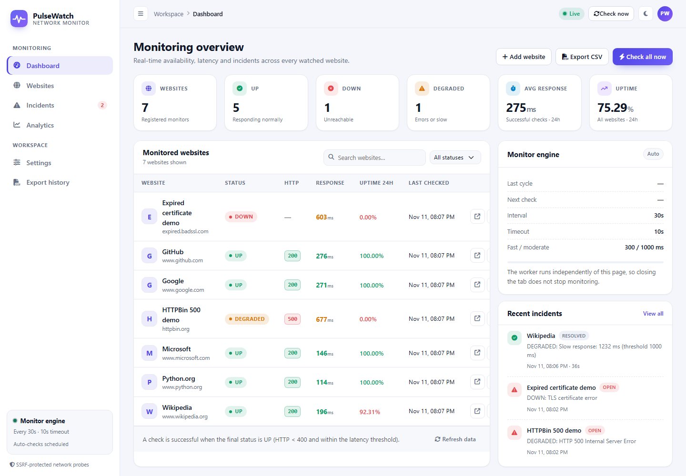
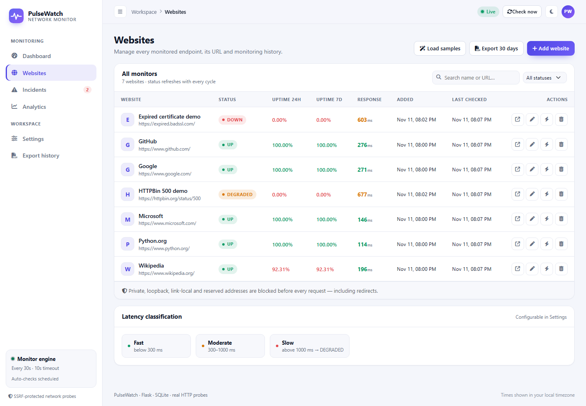
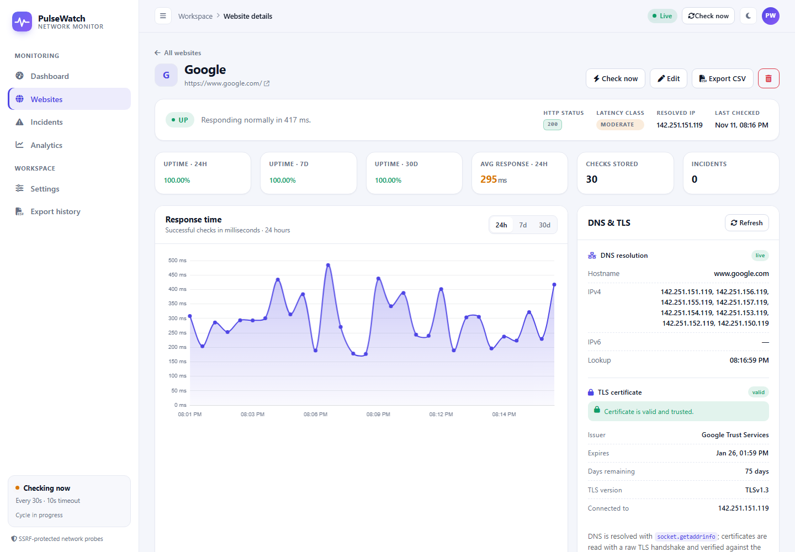
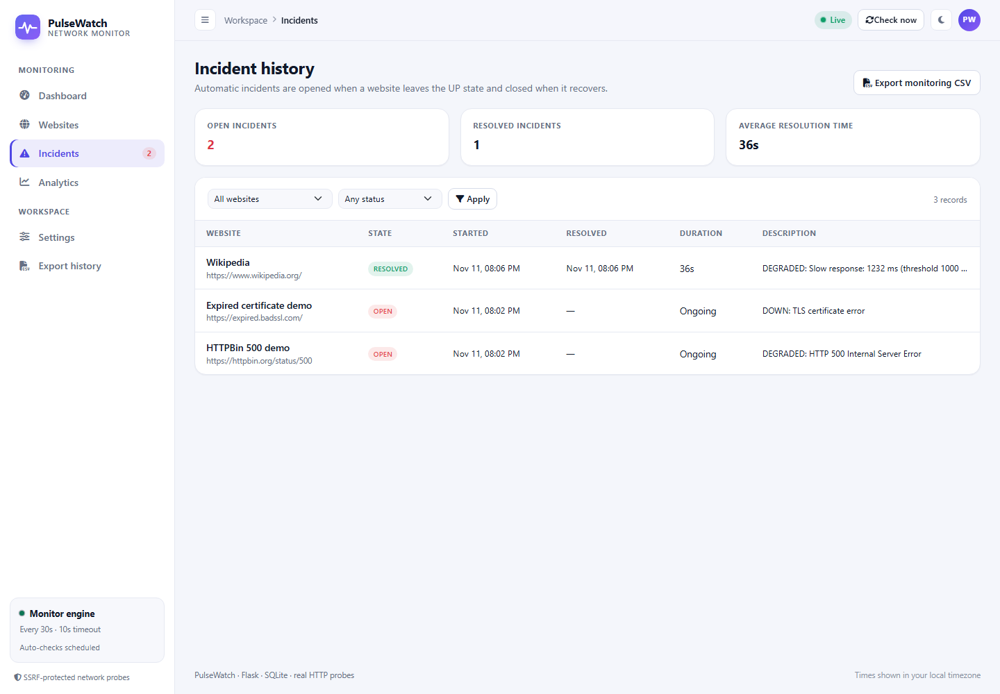
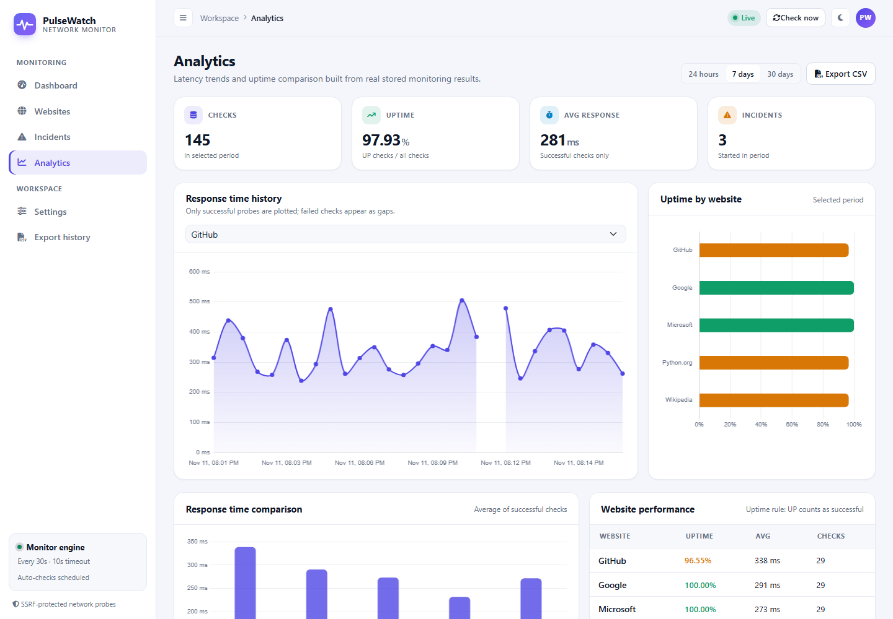
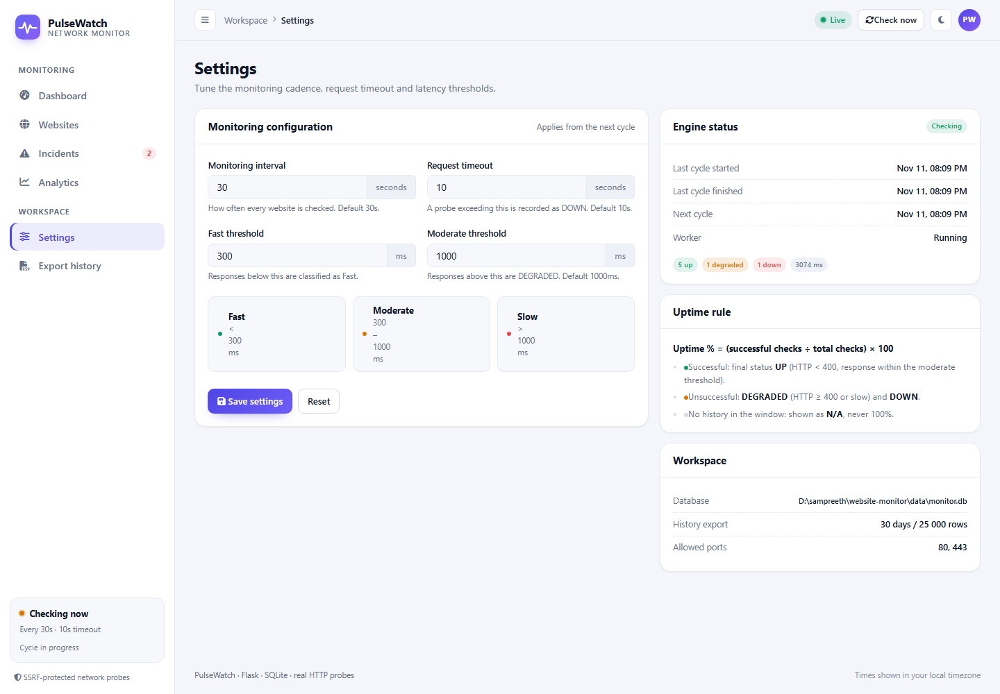
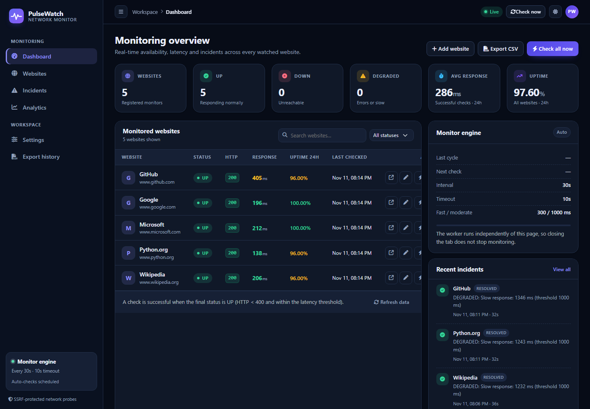
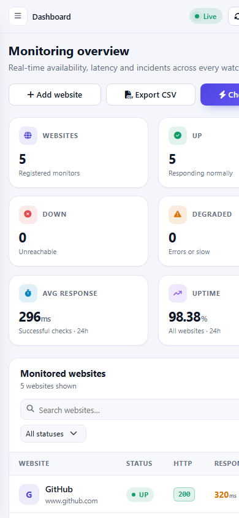

# PulseWatch — Website Availability & Performance Monitoring System

A self-hosted mini website-monitoring platform built with Flask, SQLite and real
network probes. It performs actual HTTP/HTTPS requests, DNS lookups and TLS
handshakes, then stores every result and turns them into uptime percentages,
latency charts, availability timelines and incident history.



---

## 1. Introduction

PulseWatch continuously watches a list of public websites. A background worker
probes every site on a configurable interval (30 seconds by default) and records:

* availability (UP / DEGRADED / DOWN),
* final HTTP status code and redirect count,
* measured response time in milliseconds,
* DNS resolution result (IPv4/IPv6),
* the error or timeout detail when a probe fails,
* TLS certificate validity and expiry for HTTPS sites.

The web dashboard presents this data as a professional SaaS-style console with
summary cards, a monitor table, charts, availability timelines, incident history,
CSV exports and a light/dark theme.

---

## 2. Problem statement

Website owners and network engineers need to know *when* a site is unavailable
and *why* — not just whether it loaded once. A meaningful answer needs periodic
checks, historical storage, correct uptime mathematics, latency trends, DNS
diagnostics, certificate expiry warnings, and an incident log that shows when a
problem started and ended. Doing this by hand is impossible; a small monitoring
service automates the collection and makes the history visible.

---

## 3. Objectives

1. Register and manage multiple websites with validation and duplicate protection.
2. Execute genuine HTTP/HTTPS probes — never simulated status values.
3. Classify results correctly as UP, DEGRADED or DOWN.
4. Persist every observation in SQLite and calculate uptime over 24h / 7d / 30d.
5. Run monitoring automatically and independently of the dashboard.
6. Detect incidents on availability changes and resolve them automatically.
7. Surface DNS and TLS information, including certificate expiry warnings.
8. Provide charts, timelines and CSV reporting over real history.
9. Enforce SSRF protections so only public web endpoints can be probed.
10. Remain responsive, themed and usable on desktop and mobile.

---

## 4. Screenshots

> Captured from the running application while it was probing live websites. The
> dashboard screenshot includes two temporary demo monitors (`HTTPBin 500 demo`,
> `Expired certificate demo`) that were used to verify DEGRADED/DOWN incident
> creation; they were removed afterwards.

**Dashboard** — summary cards, per-site status, latency, 24h uptime and recent incidents.


**Websites** — full management table with search, status filter, sample loader and latency classification legend.



**Website details** — live DNS and TLS panels, response-time graph, availability timeline, checks and incidents.



**Incident history** — automatic incidents with duration, description and filters.



**Analytics (24h)** — response-time history, uptime comparison and average latency comparison.


**Analytics (7 days)** — the same charts over the longer window.



**Settings** — monitoring interval, timeout, latency thresholds, engine status and uptime rule.



**Dark mode** — the same dashboard with the dark theme applied (theme is toggled in the top bar and remembered).



**Mobile layout** — the dashboard at a 390 px phone viewport: off-canvas sidebar behind the hamburger, stacked summary cards and a horizontally scrollable table with secondary columns hidden.



---

## 5. Features

### Website management
* Add, edit and delete monitored websites; view all monitors and their details.
* URL validation: only `http://` and `https://`, no credentials, ports 80/443 only.
* Duplicate URLs are rejected case-insensitively at the database level.
* One-click sample set: Google, GitHub, Wikipedia, Python.org, Microsoft.

### Availability monitoring
* Real HTTP GET probes through a pinned `urllib3` transport (the same TLS stack
  `requests` uses) with a configurable timeout (default 10s).
* Connections are pinned to the address that passed SSRF validation, so a second
  DNS answer cannot redirect a probe into a private network.
* Response time measured with `time.perf_counter()` (milliseconds).
* Manual redirect handling (max 5 hops) so the **final** status code is stored.
* SSRF protection before every hop: hostname resolution, private/loopback/
  link-local/reserved/metadata blocking, port allow-list.
* Status rules:
  * **UP** — final HTTP status < 400 and latency within the moderate threshold.
  * **DEGRADED** — HTTP 4xx/5xx, or a slow response above the moderate threshold.
  * **DOWN** — DNS failure, connection failure, TLS failure or timeout.

### Automatic monitoring
* One background scheduler thread is started per process (guarded by a lock) and
  stopped cleanly at interpreter exit; importing the module twice never duplicates it.
* It checks all websites every `monitoring_interval` seconds with concurrent probes
  via `ThreadPoolExecutor` (up to 8 workers).
* A non-blocking cycle lock prevents overlapping monitoring cycles.
* The worker is independent of HTTP requests; refreshing or closing the page does
  not stop monitoring. Settings changes apply from the next cycle.
* Run exactly one process/worker: the scheduler is in-process and a second worker
  would duplicate cycles. `render.yaml` pins Gunicorn to one worker.

### Dashboard
* Six summary cards: total websites, UP, DOWN, DEGRADED, average response time,
  overall uptime (24h).
* Monitoring table with status pills, HTTP code, latency class, uptime, last
  checked time and actions (details, edit, check now, delete).
* Client-side search and status filtering.
* Recent incident feed and monitor-engine status (last cycle, next check).
* Automatic refresh every 15 seconds via JSON polling — no page reload needed.

### Uptime
* Windows: 24 hours, 7 days, 30 days; per website and overall.
* Formula: `Uptime % = successful checks / total checks × 100`.
* A check is successful **only when it is UP**; DEGRADED and DOWN are failures.
  The same rule is used on the dashboard, details page, analytics and settings.
* No history in the window → **N/A** (never 100%).

### Analytics
* Chart.js response-time history (successful checks; failures appear as gaps).
* Average response-time comparison across websites.
* Uptime comparison bar chart with green/amber/red thresholds.
* Period selector: 24h / 7d / 30d; tooltips show status and timestamps.

### Incidents
* Incident opened when a website leaves UP for DOWN or DEGRADED.
* Open incident record keeps the original reason; a DEGRADED incident escalates
  its description if the site goes DOWN.
* Recovery to UP closes the incident and stores resolution time and duration.
* Dedicated incident page with website/state filters and average resolution time;
  recent incidents also appear on the dashboard and details page.

### Availability timeline
* Per-website bar timeline (30-minute buckets for 24h, 4-hour for 7d, daily for 30d).
* Green = all checks UP, orange = any DEGRADED, red = any DOWN, grey = no data.

### DNS & TLS
* DNS resolved with `socket.getaddrinfo`, showing IPv4 and IPv6 addresses.
* TLS certificate fetched with a raw `ssl` handshake, decoded with the standard
  library, and verified against the CA bundle (`certifi`).
* Shows issuer, subject, expiry date, remaining days, TLS version, resolved IP.
* Warning when ≤ 30 days remain; expired/invalid certificates flagged in red.
* HTTP-only websites display *Not applicable*.

### Response-time classification
* Fast < 300 ms, Moderate 300–1000 ms, Slow > 1000 ms (configurable).
* Colour-coded latency values and a legend on the websites page.

### CSV export
* Export monitoring history for all sites or one site and the chosen period.
* Columns: website name, URL, timestamp (UTC), availability status, HTTP status
  code, response time, error message, resolved IP.
* UTF-8 BOM so Excel opens it correctly.

### UI
* Professional SaaS layout: sidebar navigation, sticky top bar, cards, panels.
* Light and dark themes with localStorage persistence.
* Responsive down to mobile (off-canvas sidebar, stacked grids, scrollable tables).
* Loading skeletons for TLS/DNS panels, empty states, flash alerts and live toasts.
* All Bootstrap, Chart.js and Font Awesome assets are vendored locally — the UI
  works without any CDN or internet access (monitoring itself needs the internet).

---

## 6. Technology stack

| Layer | Technology |
| --- | --- |
| Frontend | HTML5, CSS3, JavaScript (ES2017), Bootstrap 5.3, Chart.js 4, Font Awesome 6 |
| Backend | Python 3, Flask 3.1 |
| Database | SQLite 3 (WAL mode, foreign keys, indexes) |
| Networking | `requests`, `urllib3` (pinned-IP transport), `socket`, `ssl`, `urllib.parse`, `concurrent.futures`, `threading` |
| Deployment | Gunicorn (Linux/Render), Waitress (Windows), Render Blueprint |
| Testing | pytest |

Tested on Windows 11 with Python 3.14 and exercised through the production WSGI
entry point (`app:app`). Python 3.10+ is recommended. Gunicorn itself is
Unix-only; it runs on Render's Linux runtime and was not executed on Windows.

---

## 7. Architecture

```
Browser (Bootstrap UI + Chart.js + fetch polling)
        │  HTML / JSON / CSV
        ▼
Flask application (app.py)
  ├── Pages      dashboard, websites, details, incidents, analytics, settings
  ├── JSON API   /api/dashboard, /api/websites/<id>/…
  └── CSV        /export/csv
        │
        ├── analytics.py   read models (uptime, series, timelines, incidents)
        ├── database.py    SQLite connections + schema + settings
        ├── monitor.py     HTTP probes, DNS, TLS, SSRF guards, monitoring cycle
        └── scheduler.py   daemon thread running cycles on the interval
                                  │
                                  ▼
                        SQLite (data/monitor.db)
                        websites · monitoring_results · incidents · settings
```

Request lifecycle for one probe:

1. Scheduler wakes (or user presses *Check now*).
2. Cycle lock acquired; every website is loaded from SQLite.
3. For each site a worker thread calls `perform_check()`:
   URL normalisation → DNS resolution → address safety checks → HTTP GET pinned
   to the validated address (`allow_redirects=False`) → per-hop re-validation → timing.
4. Result classified UP/DEGRADED/DOWN.
5. Result inserted, website status updated, incident state reconciled — in one
   transaction per website.
6. Dashboard polls `/api/dashboard` every 15 seconds and re-renders.

---

## 8. Database design

SQLite file: `data/monitor.db` (created automatically). WAL mode, foreign keys on,
all timestamps stored as UTC ISO-8601 (`YYYY-MM-DDTHH:MM:SSZ`) and rendered in the
browser's local timezone.

### `websites`
| Column | Type | Notes |
| --- | --- | --- |
| id | INTEGER PK | autoincrement |
| name | TEXT NOT NULL | display name |
| url | TEXT NOT NULL | normalised URL, unique (case-insensitive) |
| created_at | TEXT NOT NULL | UTC |
| current_status | TEXT | UP / DOWN / DEGRADED / UNKNOWN (CHECK) |
| last_checked | TEXT | UTC of latest probe |

### `monitoring_results`
| Column | Type | Notes |
| --- | --- | --- |
| id | INTEGER PK | |
| website_id | INTEGER | FK → websites, `ON DELETE CASCADE` |
| status | TEXT | UP / DEGRADED / DOWN (CHECK) |
| http_status_code | INTEGER | final code after redirects |
| response_time_ms | REAL | measured latency |
| error_message | TEXT | failure/degraded detail |
| checked_at | TEXT NOT NULL | UTC |
| resolved_ip | TEXT | address used for the probe |

Indexes: `(website_id, checked_at DESC)`, `(checked_at DESC)`.

### `incidents`
| Column | Type | Notes |
| --- | --- | --- |
| id | INTEGER PK | |
| website_id | INTEGER | FK → websites, cascade |
| incident_status | TEXT | OPEN / RESOLVED (CHECK) |
| started_at | TEXT NOT NULL | UTC |
| resolved_at | TEXT | UTC, null while open |
| duration_seconds | INTEGER | set on resolution |
| description | TEXT | e.g. `DEGRADED: HTTP 500 Internal Server Error` |

Indexes: `(website_id, started_at DESC)`, `(incident_status, started_at DESC)`.

### `settings`
Single row (`id = 1`): `monitoring_interval`, `timeout_seconds`,
`fast_threshold`, `moderate_threshold`. Seeded with 30 / 10 / 300 / 1000.

---

## 9. Networking concepts demonstrated

**HTTP and HTTPS.** Every check is a real HTTP GET. HTTPS sites are probed over
TLS; certificate errors surface as DOWN with a TLS-specific message.

**DNS resolution.** The hostname is extracted from the URL and resolved with
`socket.getaddrinfo()`. The resolved address is stored per check and shown on the
details page; failures are recorded as DOWN with a DNS message, and hostnames
that resolve to internal ranges are refused.

**TCP/IP communication.** Each probe is a TCP connection to port 80 or 443 on the
resolved address (via `requests`/urllib3), followed by an HTTP exchange. The
3-way handshake and TLS handshake are included in the measured response time.

**Client–server architecture.** The browser is the client of the Flask server; the
Flask server is itself a client of every monitored website. Monitoring continues
server-side regardless of browser activity.

**HTTP status codes.** Final codes after redirects are recorded. `< 400` is healthy;
`4xx`/`5xx` are DEGRADED and shown as coloured code badges. Redirect chains
(301/302/303/307/308) are followed manually up to 5 hops.

**Network latency.** Measured with a monotonic clock around the whole request
(including DNS, TCP, TLS and redirects). Classified Fast/Moderate/Slow and charted
over time.

**Request timeout.** `requests` is called with the configured timeout (default
10s); a timeout is recorded as DOWN with an explanatory error.

**SSL/TLS certificates.** The certificate is read with `ssl` and decoded to obtain
subject, issuer and validity dates. A second, verified handshake checks the chain
and hostname against the CA bundle. Expiry within 30 days raises a warning;
expired or untrusted certificates are marked invalid.

**SSRF defence (network security).** Allow-listed schemes and ports, DNS-based
private-range blocking, manual redirect validation on every hop, and metadata IP
blocking. Error messages shown in the UI never include server internals or stack
traces.

---

## 10. Installation

### Requirements
* Python 3.10+ (3.14 tested)
* Internet access for real probes
* No database server: SQLite is embedded and the file is created on first start

### Windows (PowerShell)

```powershell
cd D:\sampreeth\website-monitor
python -m venv .venv
.\.venv\Scripts\Activate.ps1
pip install -r requirements.txt
```

### Linux / macOS

```bash
cd website-monitor
python3 -m venv .venv
source .venv/bin/activate
pip install -r requirements.txt
```

`requirements.txt` is complete and platform independent (Flask, requests, urllib3,
certifi, gunicorn, waitress, pytest). The tables are created automatically; no
seed data is required.

---

## 11. Running the application

### Local development

```powershell
cd D:\sampreeth\website-monitor
.\.venv\Scripts\Activate.ps1
python app.py
```

Open <http://127.0.0.1:5000>. `python app.py` binds `0.0.0.0` and honours `PORT`
(default 5000), so the same entry point works on any OS.

The background worker starts with the application, performs an initial cycle after
2 seconds and repeats every 30 seconds. Click **Load samples** to register Google,
GitHub, Wikipedia, Python.org and Microsoft, or add your own URLs.

### Production-style run (same WSGI app Render uses)

Windows uses Waitress because Gunicorn is Unix-only:

```powershell
$env:DATABASE_PATH = "D:\sampreeth\website-monitor\data\monitor.db"
$env:SECRET_KEY = (python -c "import secrets; print(secrets.token_urlsafe(48))")
$env:ADMIN_TOKEN = "choose-a-long-admin-token"
.\.venv\Scripts\waitress-serve.exe --listen=127.0.0.1:5000 --threads=4 app:app
```

Linux / Render:

```bash
export DATABASE_PATH=/var/data/monitor.db
export SECRET_KEY="$(python -c 'import secrets; print(secrets.token_urlsafe(48))')"
export ADMIN_TOKEN="choose-a-long-admin-token"
gunicorn --workers 1 --threads 4 --bind 0.0.0.0:$PORT app:app
```

Both load the module-level `app` object, so the scheduler starts exactly once in
that process. `GET /healthz` returns `200` with database and scheduler state, or
`503` when the database is not usable. Manage sites by signing in at
`/admin/login` with `ADMIN_TOKEN`; `POST /admin/logout` ends the session.

### Environment variables

| Variable | Default | Purpose |
| --- | --- | --- |
| `DATABASE_PATH` | `data/monitor.db` | SQLite file. **Required explicitly in production**; use `/var/data/monitor.db` on Render. |
| `SECRET_KEY` | development key | Signs the admin session. **Required** in production (startup fails on the dev key). |
| `ADMIN_TOKEN` | empty | Enables `/admin/login` and remote management. If empty, only loopback requests may mutate; everybody else is read-only. |
| `PORT` | `5000` | HTTP port (Render supplies this). |
| `HOST` / `PULSEWATCH_HOST` / `MONITOR_HOST` | `0.0.0.0` | Bind address. |
| `PULSEWATCH_PRODUCTION` | auto when `RENDER` is set | Production validation, secure cookies, HSTS. |
| `TRUST_PROXY` | equals production | Trust one reverse-proxy hop for `X-Forwarded-For` / `X-Forwarded-Proto`. |
| `PULSEWATCH_SECURE_COOKIES` | equals production | `Secure` flag on the session cookie (set `0` only for plain-HTTP local smoke tests). |
| `PULSEWATCH_REQUIRE_PERSISTENT_DB` | off | Refuse to start unless the database lives under `PULSEWATCH_PERSISTENT_DB_DIR`. |
| `PULSEWATCH_PERSISTENT_DB_DIR` | `/var/data` | Directory considered persistent. |
| `PULSEWATCH_DISABLE_SCHEDULER` | off | `1` disables the background worker (tests, separate worker setups). |
| `RATE_LIMIT_GENERAL_PER_MINUTE` | `240` | Per-IP request budget. |
| `RATE_LIMIT_MUTATIONS_PER_MINUTE` | `30` | Per-IP budget for state-changing requests. |
| `RATE_LIMIT_LOGIN_PER_MINUTE` | `10` | Per-IP login attempts. |
| `LOG_LEVEL` | `INFO` | Python logging level. |
| `PYTHON_VERSION` | — | Render runtime selection (see `render.yaml`). |

`MONITOR_DB_PATH`, `MONITOR_SECRET_KEY`, `MONITOR_PORT`, `MONITOR_HOST` and
`MONITOR_DISABLE_SCHEDULER` remain accepted as aliases for backwards compatibility.

Production startup fails fast (with a clear log line, no stack trace in the
browser) when `SECRET_KEY` is still the development default or `DATABASE_PATH` was
not set explicitly. It never silently falls back to an ephemeral database.

---

## 12. Security model

* **Input validation.** Only `http://` and `https://`, ports 80/443, no embedded
  credentials, normalised and length-limited URLs, duplicates rejected case-insensitively.
* **SSRF protection.** Every hostname is resolved before connecting and every
  resolved address is checked against private, loopback, link-local, reserved,
  multicast and cloud-metadata ranges. Each redirect hop is re-validated, redirects
  are capped at 5, and non-HTTP schemes are refused.
* **DNS-rebinding protection.** The HTTP connection is pinned to the address that
  passed validation (`urllib3.HTTPSConnectionPool(host=<ip>)`) while the `Host`
  header, TLS SNI and certificate hostname stay the real hostname, so a second DNS
  answer cannot move the probe onto an internal address.
* **Access control.** The dashboard is publicly readable. When `ADMIN_TOKEN` is set,
  add/edit/delete/check/settings endpoints require a session created at
  `/admin/login`; without a token those endpoints are limited to loopback requests
  (local development). Everyone else sees a read-only dashboard with the
  management controls hidden.
* **Cross-site request forgery.** Unsafe methods are rejected with `403` when an
  `Origin`/`Referer` header is present and does not match the request host.
  Requests without either header (curl, tests, health probes) are allowed.
* **Rate limiting.** A per-IP sliding window covers general traffic, mutations and
  login attempts, returning `429` when exceeded.
* **Headers.** Content-Security-Policy, `X-Content-Type-Options: nosniff`,
  `X-Frame-Options: SAMEORIGIN`, `Referrer-Policy`, `Permissions-Policy`, and HSTS
  (`max-age=31536000; includeSubDomains`) on HTTPS in production. `ProxyFix`
  understands one proxy hop so Render's HTTPS termination is detected correctly.
* **Sessions and secrets.** HttpOnly, SameSite=Lax and (in production) Secure
  cookies; secrets come only from environment variables; no secret, database path
  or stack trace is rendered to users, and `/healthz` exposes only booleans and
  timestamps. The database path is fixed by configuration, never by request
  parameters.

---

## 13. Production deployment on Render

Render runs this repository as a Python web service with HTTPS, a health check and
an optional persistent disk. The included `render.yaml` is a Blueprint that encodes
the whole setup.

### 13.1 What Render runs

| Setting | Value |
| --- | --- |
| Runtime | Python (`PYTHON_VERSION=3.12.6`) |
| Build command | `pip install -r requirements.txt` |
| Start command | `gunicorn --workers 1 --threads 4 --bind 0.0.0.0:$PORT app:app` |
| Health check | `/healthz` |
| Workers | **1** (the scheduler must not be duplicated) |
| Disk | 1 GB mounted at `/var/data` |
| Plan | `starter` — Render only offers disks on paid instance types |

### 13.2 Why a paid instance and a disk

Render's free web services have an ephemeral filesystem and spin down after
inactivity. SQLite lives on local disk, so without a disk every deploy, restart or
wake-up would lose the monitoring history. The Blueprint therefore uses a Starter
instance and mounts `/var/data`; `DATABASE_PATH=/var/data/monitor.db` and
`PULSEWATCH_REQUIRE_PERSISTENT_DB=1` make the app refuse an ephemeral location
instead of silently starting with one. SQLite also requires a single writer, so do
not scale this service to multiple instances.

While a sleeping instance is down, the in-process scheduler cannot run; checks
resume on the next request that wakes it. Use an always-on instance type if
uninterrupted 24/7 probing is required.

### 13.3 Publish the code to GitHub

Create an **empty** repository on GitHub (no README, no `.gitignore`), then from
PowerShell in the project folder:

```powershell
cd D:\sampreeth\website-monitor
git init
git add .
git commit -m "Production-ready PulseWatch: env config, auth, SSRF pinning, Render deployment"
git branch -M main
git remote add origin https://github.com/<your-github-user>/pulsewatch.git
git push -u origin main
```

`.gitignore` already excludes `.venv/`, `data/`, `*.db`, `.env`, logs and caches.
Before pushing, confirm no data or secrets are staged:

```powershell
git status --short
git ls-files | Select-String -Pattern "\.db$|\.env$|monitor\.db"
```

The second command should print nothing. If `data/monitor.db` slips in, run
`git rm --cached -r data` and commit again; never commit the database.

### 13.4 Create the Render service

1. Sign in to <https://render.com> with the same GitHub account.
2. **New +** → **Blueprint**, select the repository. Render reads `render.yaml`.
3. On the review screen set **`ADMIN_TOKEN`** to a long random value (Render stores
   it as a secret; `SECRET_KEY` is generated automatically). Keep the Starter plan
   and the 1 GB disk.
4. **Apply** / **Deploy**. The first build installs `requirements.txt`; the start
   command launches Gunicorn.
5. Watch the logs for `Database ready at /var/data/monitor.db`, one
   `Monitoring scheduler started`, and Gunicorn's listening line. The health check
   turns the deploy green.
6. Open the public URL Render shows, e.g. `https://pulsewatch-xxxx.onrender.com`.
7. Go to `/admin/login`, enter `ADMIN_TOKEN`, then use **Load samples** or add your
   own sites. The first cycle runs within ~30 seconds and history starts filling.

If you prefer a manual service instead of the Blueprint: create a **Web Service**,
choose Python, set the build and start commands above, add the environment
variables from section 11, and add a disk with mount path `/var/data`.

### 13.5 Verify the deployment

```powershell
curl https://<service>.onrender.com/healthz
curl -I https://<service>.onrender.com/
```

* `/healthz` → `{"status":"ok","database":{"ok":true,...},"scheduler":{"running":true,...}}`
  with `"persistent":true` when the disk is mounted.
* The HTTPS response includes `Strict-Transport-Security`.
* The dashboard shows real per-site latency, HTTP codes and rising check counts.
* Sign in at `/admin/login` and confirm adding, checking and deleting a site works;
  a signed-out visitor should get read-only pages and `403` for mutations.

### 13.6 Troubleshooting

| Symptom | Cause / fix |
| --- | --- |
| Deploy fails with `SECRET_KEY must be set...` | Add a strong `SECRET_KEY` (the Blueprint generates one). |
| `DATABASE_PATH must be set explicitly in production` | Set `DATABASE_PATH=/var/data/monitor.db`. |
| `DATABASE_PATH ... is outside the persistent directory` | Disk not mounted at `/var/data`, or `PULSEWATCH_PERSISTENT_DB_DIR` mismatched. |
| History disappears after a deploy | No disk attached (free instance); attach one and redeploy. |
| `403` when adding a site | Sign in at `/admin/login`, or set `ADMIN_TOKEN`. |
| `429 Too Many Requests` | Per-IP rate limit; wait a minute or raise `RATE_LIMIT_*`. |
| No new checks / `scheduler.running=false` | `PULSEWATCH_DISABLE_SCHEDULER` set, or the instance is asleep. |
| Build cannot find `app:app` | Start command must reference `app:app` from the repository root. |
| Gunicorn fails locally on Windows | Expected: Gunicorn is Unix-only. Use Waitress locally; Render runs Linux. |

---

## 14. Usage guide


1. **Add a website** — *Add website* on the dashboard or websites page; `example.com`
   is accepted and normalised to `https://example.com/`.
2. **Check now** — the bolt icon checks a single site synchronously; *Check all now*
   triggers a full cycle in the background.
3. **Details** — click a website for DNS, TLS, uptime, response graph, timeline,
   recent checks and incidents.
4. **Analytics** — choose 24h / 7d / 30d; pick a website for the history chart.
5. **Incidents** — automatic history with filters; a resolved incident shows its
   duration.
6. **Export** — CSV download from the dashboard, website, analytics or incidents pages.
7. **Settings** — interval, timeout and latency thresholds; the engine status card
   shows the most recent cycle.

### HTTP endpoints

| Method | Path | Purpose |
| --- | --- | --- |
| GET | `/` | Dashboard |
| GET | `/websites` | Website management |
| GET | `/websites/<id>` | Details (`?hours=24|168|720`) |
| POST | `/websites/add` | Create monitor |
| POST | `/websites/samples` | Add the five sample websites |
| POST | `/websites/<id>/edit` | Update name/URL |
| POST | `/websites/<id>/delete` | Delete (cascades history) |
| POST | `/websites/<id>/check` | Check one site immediately |
| POST | `/check-now` | Start a full cycle |
| GET | `/incidents` | Incident history (`?status=`, `?website_id=`) |
| GET | `/analytics` | Analytics (`?hours=`) |
| GET/POST | `/settings` | View / update settings |
| GET | `/export/csv` | CSV download (`?hours=`, `?website_id=`) |
| GET | `/api/dashboard` | Dashboard snapshot JSON |
| GET | `/api/status` | Engine + settings JSON |
| GET | `/api/analytics/comparison` | Per-site average latency & uptime |
| GET | `/api/analytics/summary` | Period summary |
| GET | `/api/websites/<id>/history` | Response-time series |
| GET | `/api/websites/<id>/timeline` | Availability buckets |
| GET | `/api/websites/<id>/dns` | Live DNS lookup |
| GET | `/api/websites/<id>/ssl` | Live TLS inspection (`?refresh=1` bypasses cache) |
| GET | `/admin/login` | Administrator sign-in form |
| POST | `/admin/login` | Verify `ADMIN_TOKEN` and start an admin session |
| POST | `/admin/logout` | End the admin session |
| GET | `/healthz` | Database + scheduler health (`503` when the database is unusable) |

Endpoints that change state require an admin session when `ADMIN_TOKEN` is set,
are rate limited per client IP, and reject cross-origin POSTs.

---

## 15. Testing

```bat
.venv\Scripts\activate
python -m pytest -q
```

**Result on this build: `67 passed` in ~18 seconds.** No external network is used:
DNS, HTTP and TLS layers are mocked, and the app runs against a temporary SQLite
file with the scheduler disabled.

Coverage of the required scenarios:

| Scenario | Test |
| --- | --- |
| HTTP 200 → UP | `test_http_200_is_up` |
| HTTP 301 followed, final status stored | `test_http_301_redirect_followed_to_final_status` |
| HTTP 404 → DEGRADED | `test_http_404_is_degraded` |
| HTTP 500 → DEGRADED | `test_http_500_is_degraded` |
| Unreachable host → DOWN | `test_unreachable_host_is_down` |
| Timeout → DOWN | `test_timeout_is_down` |
| DNS failure → DOWN | `test_dns_failure_is_down` |
| Valid certificate | `test_ssl_valid_certificate_summary` |
| Expired / soon-expiring certificate | `test_ssl_expired_certificate`, `test_ssl_expiring_soon_warns` |
| Multiple sites monitored together | `test_cycle_monitors_multiple_sites_and_creates_incidents` |
| Duplicate URL rejected | `test_duplicate_urls_rejected` |
| Uptime calculations | `test_uptime_calculation_and_success_rule`, `test_uptime_is_none_without_history` |
| Incident creation and recovery | `test_incident_closes_on_recovery` |
| CSV export | `test_csv_export` |
| Remote visitor is read-only | `test_remote_visitor_gets_read_only_dashboard` |
| Admin login/logout and gated mutations | `test_admin_login_logout_and_remote_management` |
| Cross-origin POST rejected | `test_cross_origin_post_is_rejected` |
| Mutation rate limit returns 429 | `test_mutation_rate_limit_returns_429` |

Additional tests cover SSRF blocking (loopback literal, private DNS answers,
redirects into private ranges, non-HTTP schemes, credentials, non-standard ports),
URL normalisation, redirect loops, TLS errors, cycle overlap protection, settings
validation, cascading deletes, API responses, empty uptime (N/A) and part of the
timeline/analytics maths.

### Live verification performed

While building this project the running app was checked against the public internet:

* Five sample sites returned real `200` responses with per-site latency and IPv4 addresses.
* A `500` response produced `DEGRADED` and an open incident; an expired certificate
  produced `DOWN` with `TLS certificate error` and its own incident.
* Editing the URLs back to healthy endpoints made the next real cycle close both
  incidents with recorded durations (462s and 461s).
* Google's certificate was read successfully: issuer *Google Trust Services*,
  TLSv1.3, 75 days remaining.
* Duplicate URLs and `http://127.0.0.1:5000/` were rejected without creating rows.

### Production-mode smoke test (this build)

* Served the exact `app:app` entry point with Waitress in production mode, an
  explicit `DATABASE_PATH` and `ADMIN_TOKEN`: `/healthz` reported `production`, a
  healthy/writable database and a running scheduler, which started exactly once.
* Five sample sites were monitored for real over HTTPS, with real latency, resolved
  IPs, uptime and CSV rows. The pinned transport initially received a bot-policy
  `403` from Wikimedia because it used a plain stdlib TLS context; switching to the
  urllib3 context that `requests` uses fixed it, and all five sites reported `UP`/`200`.
* A remote (non-loopback) visitor received read-only pages and `403` for mutations
  until signing in at `/admin/login`; a wrong token was rejected.
* DNS and TLS panels returned live data (Google Trust Services, TLSv1.3), CSV
  exported stored checks, and `Strict-Transport-Security` appeared for HTTPS requests
  forwarded by a trusted proxy (Render terminates TLS in front of Gunicorn).
* Restarting the server kept all sites and history, confirming the explicit database
  path is durable. Gunicorn itself could not be executed on Windows (Unix-only); the
  same WSGI object was exercised with Waitress and the exact Gunicorn command is
  configured for Render.

---

## 16. Project structure

```
website-monitor/
├── app.py                  Flask app factory, pages, JSON API, CSV, error handlers
├── config.py               Environment-driven configuration (paths, auth, limits)
├── database.py             SQLite connections, schema init, settings helpers
├── schema.sql              Tables, checks, foreign keys, indexes
├── monitor.py              Pinned HTTP probes, DNS, TLS, SSRF guards, cycle
├── scheduler.py            Background monitoring worker (one per process)
├── security.py             Access control, origin check, rate limiting
├── analytics.py            Uptime, overview, series, timeline, incidents, CSV rows
├── requirements.txt
├── render.yaml             Render Blueprint: Python, disk, env vars, health check
├── Procfile                Alternative start command for other PaaS hosts
├── .env.example            Environment template (no secrets)
├── README.md
├── data/
│   └── monitor.db          Created at runtime (gitignored)
├── templates/
│   ├── base.html           Shell: sidebar, topbar, theme script, modals, scripts
│   ├── _macros.html        Status pill, latency, code badge, empty state
│   ├── _website_modal.html Shared add/edit dialog
│   ├── dashboard.html
│   ├── websites.html
│   ├── website_details.html
│   ├── incidents.html
│   ├── analytics.html
│   ├── settings.html
│   ├── admin_login.html    Administrator sign-in
│   └── error.html
├── static/
│   ├── css/style.css       Design system, light/dark themes, responsive rules
│   ├── js/dashboard.js     Theme, polling, filters, modal/confirm, toasts
│   ├── js/charts.js        Chart.js graphs, timeline, DNS/TLS panels
│   ├── images/logo.svg
│   ├── vendor/             Bootstrap, Chart.js, Font Awesome (local copies)
│   └── webfonts/           Font Awesome webfonts
├── tests/
│   ├── conftest.py
│   ├── test_monitor.py
│   ├── test_analytics.py
│   ├── test_routes.py
│   └── test_security.py    Auth, origin, rate limit, DB path guards
└── docs/screenshots/       Screenshots used in this README
```

---

## 17. Design decisions

* **Only UP counts as successful.** DEGRADED (4xx/5xx or slow) is an unhealthy
  response and therefore reduces uptime; DOWN certainly does. Keeping one rule
  everywhere avoids the common mistake of reporting 100% uptime for a site that
  always returns 500.
* **The first check of a site that is not UP opens an incident.** This avoids
  losing an ongoing outage that began before monitoring did.
* **Timestamps in UTC, formatting in the browser.** SQLite stores sortable UTC
  strings; the UI converts them with `Intl.DateTimeFormat`, so ranges and
  lexicographic comparisons stay correct.
* **Manual redirect handling** is slightly more code than `allow_redirects=True`
  but is required to validate each hop against SSRF.
* **Vendored frontend libraries** keep the dashboard usable on an intranet and make
  rendering deterministic in screenshots.

* **Management is authenticated, reading is not.** The dashboard is a public
  read-only view; only the small set of mutating endpoints is gated. That keeps
  the demo shareable while preventing anonymous edits and deletions.

---

## 18. Known limitations

* **One validated address per request.** The connection is pinned to the first
  address that passed validation; if that edge is unreachable the probe records a
  failure instead of retrying other A/AAAA records. Probes from datacenter IPs can
  also be refused by bot protection (stored as `DEGRADED`, a real response).
* **Port restriction.** Only ports 80 and 443 are monitored, by design; a site on
  port 8080 cannot be added.
* **Single shared administrator secret.** `ADMIN_TOKEN` is one password for all
  management rather than per-user accounts; sessions are signed cookies. The public
  dashboard is intentionally read-only for anonymous visitors.
* **Worker state is in memory** (last/next cycle time). History, websites and
  incidents are durable in SQLite; run exactly one scheduler process.
* **One probe URL per website.** SSL information is derived from the stored URL's
  scheme; an HTTP-only site reports TLS as not applicable.
* **TLS inspection is cached for 10 minutes** per host to keep the details page fast.
* **Charts, live polling, DNS/TLS refresh and relative times need JavaScript**;
  server-rendered tables and uptime values remain available without it.
* **Export limits:** 25 000 rows per CSV, selectable window up to 30 days.
* **One process only.** The scheduler runs in-process and SQLite has a single writer,
  so production uses one Gunicorn worker and cannot be horizontally scaled.
  `python app.py` uses Flask's development server; the production entry point is
  `app:app` behind Gunicorn (Linux/Render) or Waitress (Windows).
* **No alert notifications** (email/SMS/Slack) in this version.

---

## 19. Future enhancements

* Multi-user accounts and roles instead of one shared `ADMIN_TOKEN`.
* Fallback across all validated A/AAAA records when one edge is unreachable.
* Email/Slack/webhook alerting on incident open/close.
* Configurable per-website intervals, methods, expected status codes and keywords.
* Latency percentiles (p95/p99), SLA reports and scheduled PDF/CSV digests.
* Retention policy/archiving to keep the SQLite file bounded.
* Additional checks: TCP port reachability, traceroute summary, HTTP header audit.
* Container image and a systemd/Windows service installation recipe.
